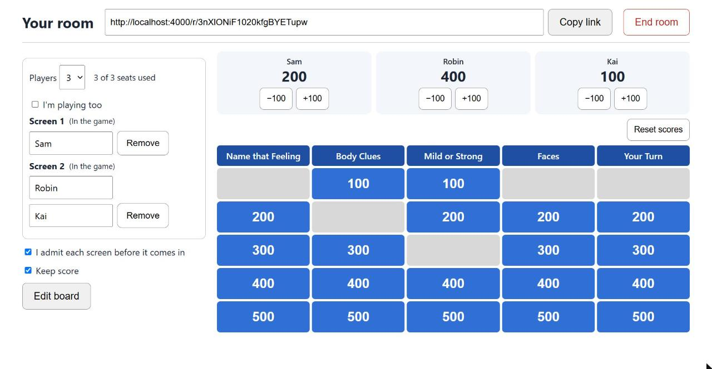
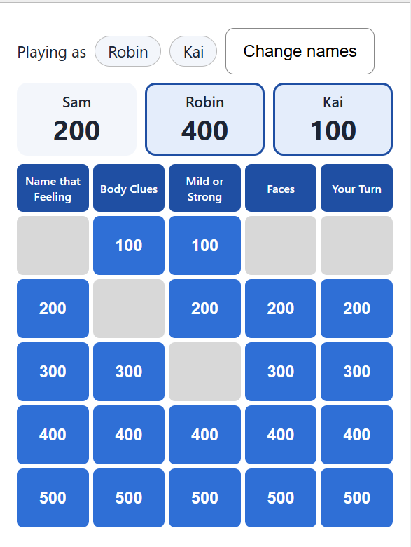
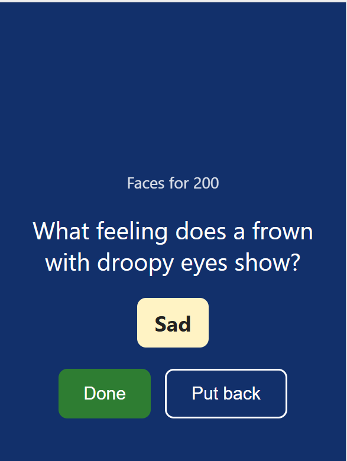
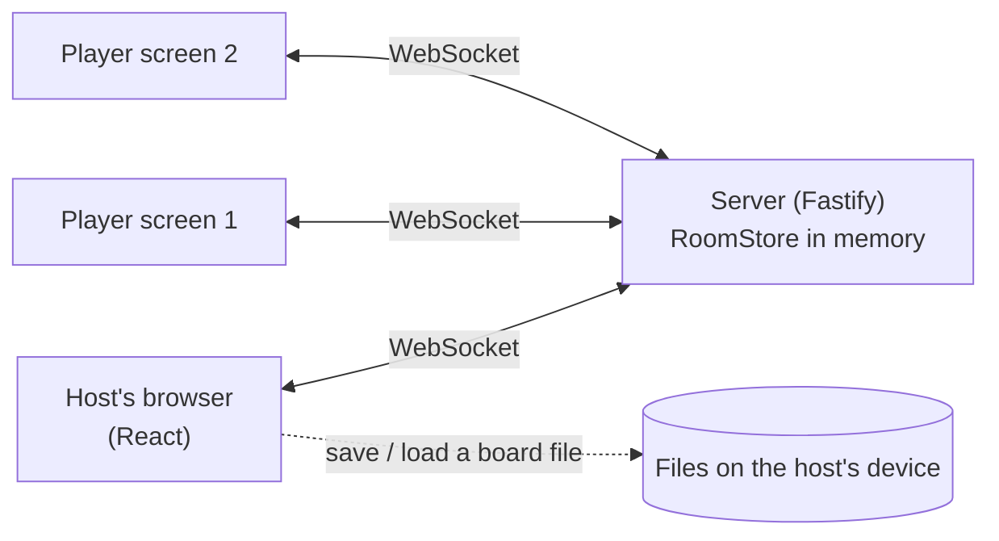

# therapy-play

[](https://github.com/omnidox/therapy-play/actions/workflows/ci.yml)

A shared Jeopardy-style game for online sessions with children. One adult opens a room and emails a link. Up to eight players join from phones, tablets or computers, and everyone sees the same board live. Nothing is stored on the server.

It is built to sit next to a video call, not replace it.

## Screenshots

The host's screen (a game in progress with three players and scoring on), then a player's phone screen and a clue. All content is made up: the example board and the names Robin, Kai and Sam.



<p>
  
  
</p>

## What it does

- **Rooms with a link.** The host creates a room and gets an unguessable link. There are no accounts. Players type no name unless they want to.
- **Waiting room.** Each new screen waits until the host admits it (this can be switched off).
- **Up to 8 players.** The host picks the number (1 to 8). One screen can hold up to 4 players, for example a parent and child sharing a phone. The host can play too. Players can rename themselves.
- **A live board.** Any admitted player can open a tile. Questions and answers are sent only when a tile is opened. **Show answer**, **Done** (the tile is used up) and **Put back** (it stays available) work for everyone.
- **Scoring is optional.** Only the host can switch it on and award points, one player at a time.
- **Editable boards.** The host edits categories, questions, answers and points, starts from three placeholder example boards, and saves or loads a board as a file on their own device. The server never stores boards.
- **Phone first for players, computer first for the host.** The player's screen is built for a phone held upright. The host's screen is a two-column layout that fits in half a laptop window next to a video call.
- **Survives real-world connections.** A phone that locks its screen or loses Wi-Fi reconnects by itself and takes its seat back. Closing the browser and reopening the link within 15 minutes does too.
- **Keyboard and screen reader friendly.** Pop-ups trap and return focus, Escape works, and answers and scores are announced.

## How it works



- The **server owns the game.** Clients send small actions ("open this tile"); the server applies them in order and sends the new state to everyone. If two people tap at once, the first wins.
- **Rooms live only in memory** and disappear when the host ends them or after 30 idle minutes.
- The pieces share their message types in `shared/`, so the client and server cannot drift apart without the type checker noticing.

Longer reasoning for the main choices is in [docs/decisions](docs/decisions/).

## Run it

You need Node.js 22 or newer.

```
npm install
npm run dev:server   # terminal 1: server on port 3001
npm run dev:client   # terminal 2: page on http://localhost:5173
```

Open `http://localhost:5173` and press **New room**. To try several players in one browser, add `?fresh` to a player link (for example `/r/CODE?fresh`), because tabs of one browser share a seat code.

To try it on a phone on the same Wi-Fi, run `npm run dev:phone` instead of `dev:client`, and open the "Network" address it prints (on both the host and the phone).

## Run it for real (production build)

```
npm ci
npm run build   # builds the page and bundles the server
npm start       # one program: serves the page, the game and /health
```

The port comes from the `PORT` setting (default 3001). Any computer or hosting service with Node.js 22 can run it this way. See [docs/decisions/0009](docs/decisions/0009-one-program-serves-page-and-game.md). Rooms live in memory, so run a single copy.

## Tests and checks

```
npm run check
```

runs, in order: the TypeScript check, ESLint, a Prettier format check, and all tests.

- **Server tests** cover the room rules (admitting, seats, scoring permissions, timeouts), the game rules, board validation, and real WebSocket conversations between a host and several players, including a connection that stops answering.
- **Client tests** cover focus handling, Escape behaviour and the editor, and run an automated accessibility scan (axe) on each screen.
- A pre-commit hook in `.githooks/` runs the same check and blocks a commit that fails it. Turn it on once per clone with `git config core.hooksPath .githooks`, run from the folder that contains `.githooks`.

## Project layout

- `server/`: Node.js, Fastify and WebSockets. `rooms.ts` holds the room and player rules, `game.ts` the game rules.
- `client/`: React, TypeScript and Vite.
- `shared/`: message types, board rules and the starter boards, used by both sides.
- `docs/decisions/`: short decision records.

## Privacy: what it stores and does not

- The server keeps rooms **in memory only**. There is no database, no accounts, and no analytics. The server writes no logs about rooms or people.
- A room's board, scores and player names exist only while the room does.
- Each device keeps two random codes for a room (the host's key and a player's seat code) so a closed browser can return. They identify nobody, are removed when the room ends, and expire after a day.
- Boards are saved only as files the host chooses to download.

This is a description of what the code does, not a compliance statement. It has not had a privacy or security review and is not ready for real sessions with children.

## Known limits

- **One server process.** Rooms are in memory, so running several server copies would split them. This is a deliberate trade-off (see the decision records).
- **No end-to-end browser tests yet.** The logic and the screens are tested, and the full flow has been checked by hand in a real browser.
- **Accessibility is partly covered.** Automated scans and keyboard checks are done; colour-contrast scanning in a real browser and testing with a real screen reader are not.
- **No video.** It is meant to be used beside one.
- **Placeholder content.** The three example boards are made-up samples meant to be edited or replaced.

## How it was built and how it was checked

This project was built with AI assistance: pair-programming with Claude Code (Anthropic). A person set the requirements, made the design decisions, reviewed the results and tried the app on real devices. The AI wrote most of the code and tests under that direction.

Checks that stand behind it: the automated tests and the pre-commit hook above, a strict TypeScript setup, hand testing in a real browser (including cutting a live connection on purpose and using only the keyboard), and testing on a phone. What was not checked is listed under Known limits.

## What might come next

More shared activities for the same rooms, such as a drag-and-drop scene and a story board, and an optional video connection through a provider that signs the right agreements.

## License

[MIT](LICENSE).
